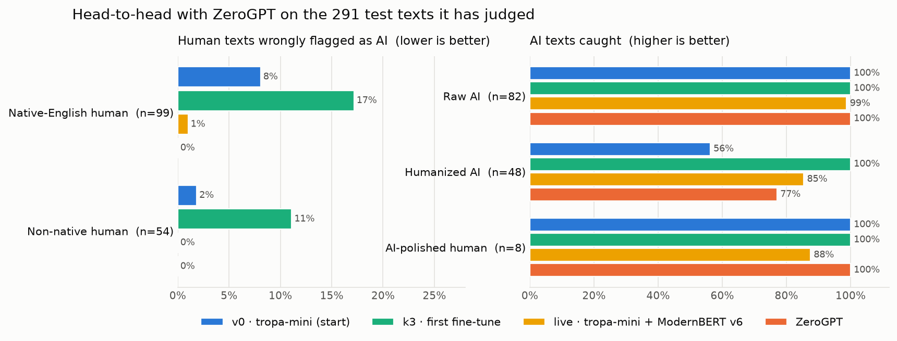
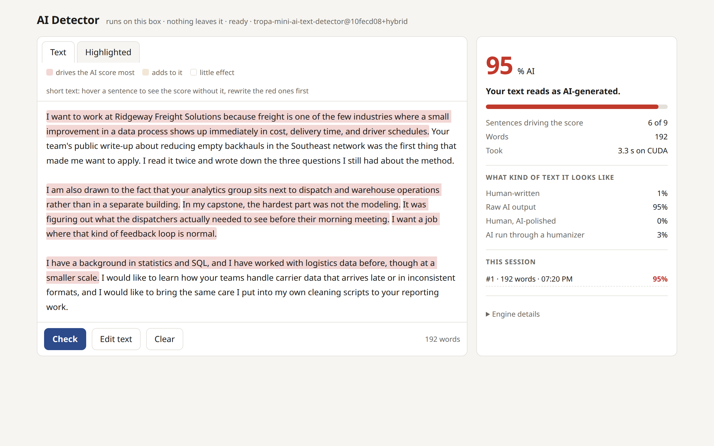
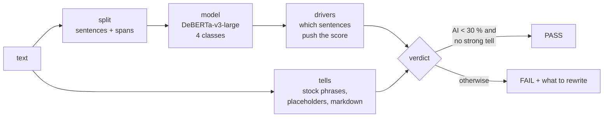
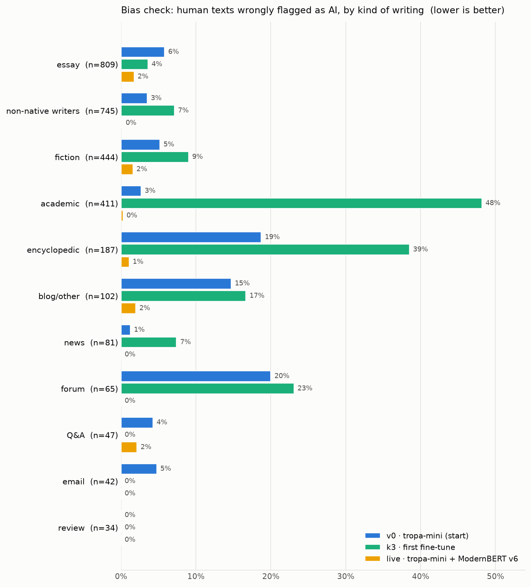
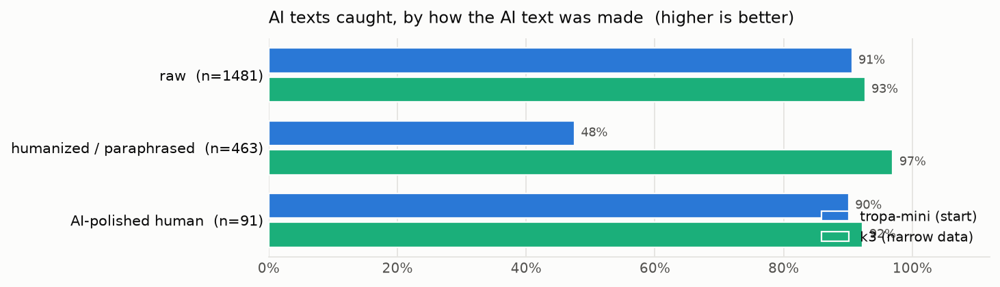
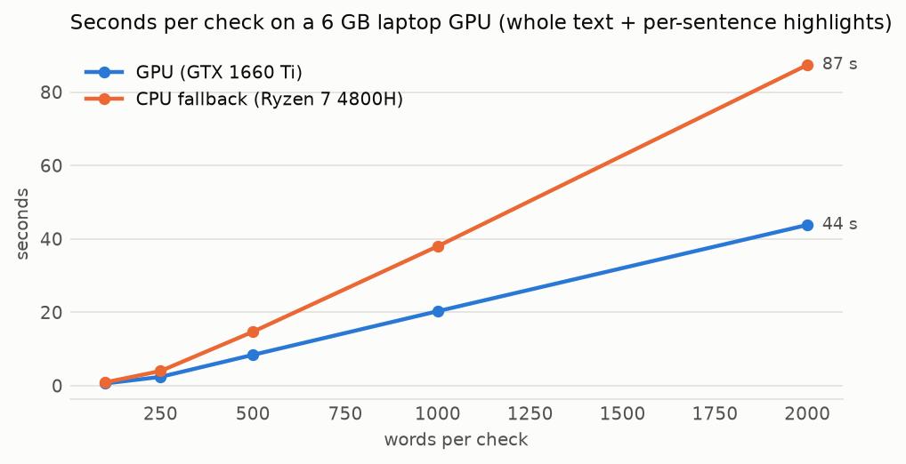

<div align="center">

# 🔎 local-ai-detector

**An AI-text detector that runs on a 6 GB laptop GPU — and a PASS/FAIL gate AI agents use on their own drafts.**

Built in the open, measured honestly against ZeroGPT, and judged by an independent GPT-6.1 reviewer.

-2a78d6)


<picture>
  <source media="(prefers-color-scheme: dark)" srcset="docs/img/headtohead-dark.png">
  
</picture>

</div>

## What it is

- **A local detector.** Paste text, get the % AI and *which sentences* drive it. Nothing is sent anywhere: the model
  loads from the local cache, texts are never logged.
- **A gate for agents.** `ai-check draft.txt` → exit `0` PASS / `1` FAIL / `2` couldn't check, with the sentences to
  rewrite and the "AI tells" to remove. Agents run it before they hand over an email or an application answer that
  will go out under a person's name. → [Verify API](docs/verify-api.md)
- **A public record of how it was built**: data, training runs, costs, failures, bias checks and independent
  reviews, round by round. → [The process](docs/process.md)

## Status

The goal: a **frontier-level** detector — at least as accurate as ZeroGPT on fresh texts, with **no human subgroup
unfairly flagged** (non-native writers, academic, encyclopedic, casual) and a high catch rate on current models and
humanized text — that still runs on a GTX 1660 Ti. The bar is checked by an independent reviewer (GPT-6.1 Sol)
that builds its own fresh test set each round.

| Model | Held-out accuracy vs ZeroGPT¹ | Worst human group flagged | Humanized AI caught | Independent review |
|---|---|---|---|---|
| **v0** tropa-mini, as published | 89.7 % vs 96.2 % | 20 % (forum posts) | 48 % | 9.0/10 · not ≥ ZeroGPT |
| **k3** full fine-tune, narrow data | 92.1 % vs 96.2 % | **48 % (academic)** ✗ | 97 % | not deployed (bias) |
| **v4** + domain-balanced data | _training_ | | | |
| **ModernBERT-large** (ensemble partner) | _training_ | | | |

¹ the 291 held-out texts ZeroGPT has also judged; everything else in [evaluation](docs/evaluation-v0.md).

## What it looks like



<sub>A fictional, AI-written application answer. Red = the sentences whose removal lowers the score most; hover one to
see the score without it. Agents get the same information as JSON from <code>POST /verify</code>.</sub>

## How a check works



- **Short texts** (emails, form answers, ≤ 225 words) are re-scored once *without each sentence*: the sentences
  whose removal drops the score most are the ones to rewrite. Longer texts use ~150-word windows.
- **Strict like a CI gate:** a check that didn't run is a FAIL, never a pass. Verdicts are cached by SHA-256 + every
  version, never by text.
- Details: [how it works](docs/how-it-works.md).

## Quick start

```bash
git clone https://github.com/AdityaBaranwal1/local-ai-detector && cd local-ai-detector
uv venv --python 3.13 .venv
uv pip install --python .venv/bin/python --index-url https://download.pytorch.org/whl/cu126 torch==2.14.1
uv pip install --python .venv/bin/python -r requirements.txt
.venv/bin/hf download wasitaigeneratedcom/tropa-mini-ai-text-detector      # or point AI_MODEL at a fine-tuned dir
.venv/bin/python -m uvicorn detector.server:app --host 127.0.0.1 --port 8323

# then
open http://127.0.0.1:8323/                     # paste page
bin/ai-check my-email.txt; echo "exit $?"       # agents
```

Running it as a service next to other GPU jobs, behind Tailscale: [homelab.md](docs/homelab.md).

## Results so far

<picture>
  <source media="(prefers-color-scheme: dark)" srcset="docs/img/bias_domain-dark.png">
  
</picture>

The first fine-tune (k3) learned a shortcut: *formal = AI*. It caught 97 % of humanized AI text — far above
ZeroGPT's 77 % — but flagged half of real academic writing. The fix in progress is data in which **every domain has
both human and AI text**, and choosing checkpoints by their **worst** domain, not their average.

<picture>
  <source media="(prefers-color-scheme: dark)" srcset="docs/img/ai_styles-dark.png">
  
</picture>

<picture>
  <source media="(prefers-color-scheme: dark)" srcset="docs/img/speed-dark.png">
  
</picture>

## How it's evaluated

- **Never on training data.** Held-out splits plus whole datasets the model never saw (MAGE, HC3, ArguGPT,
  COLING-2025, a 2026 benchmark, learner essays), deduplicated against training by hash.
- **Bias report** for every version: false-positive rate by writer (native / non-native), domain, register and
  length; catch rate by model family, style and length; the headline is the *worst* group. → `eval/bias.py`
- **Head-to-head with ZeroGPT** on the same texts.
- **Independent review**: GPT-6.1 Sol builds a fresh, deliberately hard set each round, runs both detectors and
  scores ours (round 1: [REPORT.md](eval/sol/round-1/REPORT.md)). The builder never trains on its texts.

## Training

Full fine-tunes on **Kaggle** (free T4) and **Runpod** (pay-per-minute, with a hard price cap, a watchdog that
deletes the pod, and a cost ledger) — [training](docs/training.md). The served model stays small enough for the
6 GB card; better data does the heavy lifting.

## Limits and responsible use

A detector score is **evidence, not proof**. Every detector, this one included, makes mistakes — most often on short
texts, formal writing and writers whose first language isn't English. Don't use it as the only basis for a decision
about a person. This project measures those failure modes in public precisely because they matter.

## Credits

Starts from [tropa-mini](https://huggingface.co/wasitaigeneratedcom/tropa-mini-ai-text-detector) (Apache-2.0), itself
fine-tuned from [desklib/ai-text-detector-v1.01](https://huggingface.co/desklib/ai-text-detector-v1.01) on
[DeBERTa-v3-large](https://huggingface.co/microsoft/deberta-v3-large). Data: Jabarian & Imas 2025 (DetectionAI),
ELLIPSE, ICNALE, DAIGT, RAID, MAGE, COLING-2025 MGT, HC3, AESLC, webis/tldr-17, WritingPrompts — see
[NOTICE](NOTICE). Code: MIT.
