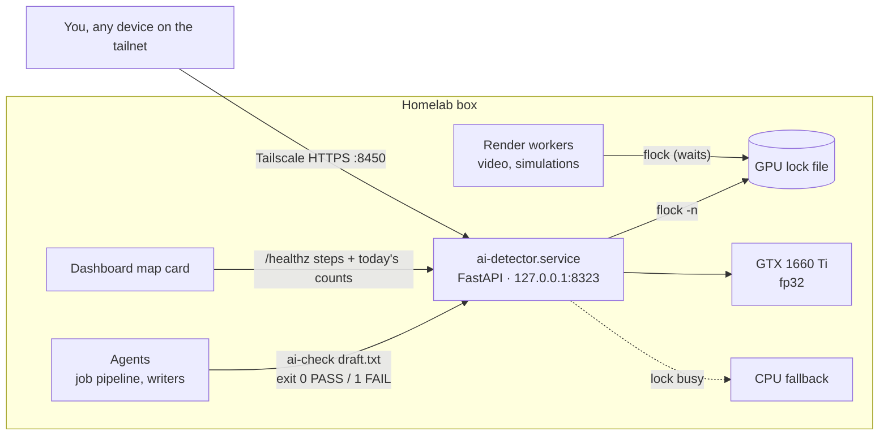

# Running it on a homelab

The detector was built to live on an always-on laptop (GTX 1660 Ti, 6 GB) next to other GPU jobs, and to be called
by AI agents on the same box. This is how that is wired; adapt the paths to yours.

## The service

- `deploy/ai-detector.service` is a **systemd user unit** (`%h` = your home). Install:
  `cp deploy/ai-detector.service ~/.config/systemd/user/ && systemctl --user daemon-reload && systemctl --user enable --now ai-detector`.
- It listens on **127.0.0.1:8323 only**. Reach it from other devices through `tailscale serve --bg --https=8450 http://127.0.0.1:8323`
  (tailnet-only HTTPS, never Funnel: people paste private drafts into it).
- `HF_HUB_OFFLINE=1`: the model comes from the local Hugging Face cache; nothing is downloaded or sent at run time.
  Texts are never logged; verify verdicts are stored by SHA-256 only (`data/verdicts.sqlite`, directory mode 0700).
- `AI_MODEL` (environment) picks the model: a Hugging Face id or a fine-tuned directory under `models/`.

## Sharing one small GPU

Other jobs on the box (video renders, physics simulations) run every GPU job under `flock <lock file>`. The detector
uses the **same lock**, but never blocks on it:

- each check tries `flock -n`; free → the model is copied to VRAM (fp32, ~1.7 GB) and the check runs on the GPU;
- held by a render → the check runs on the CPU instead (~2× slower);
- after a check it keeps the GPU for 60 s (`GPU_IDLE_S`), and **gives it back within ~2 s as soon as anything is
  waiting** on the lock (it watches `/proc/locks`); a render arriving mid-check waits only for that check;
- it never creates the lock file (the workers bind-mount it by inode).

**fp32, not fp16.** On a GTX 16-series card (Turing without tensor cores) fp16 matrix multiplies ran at 0.6 TFLOPS
against 4.4 TFLOPS in fp32 — half precision was ~4× slower end to end. Check this on your own card before assuming
fp16 is faster.

## Agents

Every agent on the box gets one rule (in the box's shared agent instructions):

> Before you hand over text that will go out under the owner's name — an email, an application or form answer,
> a cover letter, a message — run `ai-check <file>`. Exit 0 = PASS. Exit 1 = FAIL: rewrite the sentences and tells
> it lists, keep every fact, check again. Exit 2 = it couldn't check: say so, don't claim a pass.

The full API is in [verify-api.md](verify-api.md).

## Dashboard

The homelab dashboard's service map draws the detector as a card whose four checks (split → model → drivers → tells)
are coloured live from `GET /healthz` `steps`, with a line like "12 checks today · 3 FAIL · GPU free". Only counts
are exposed, never text.
